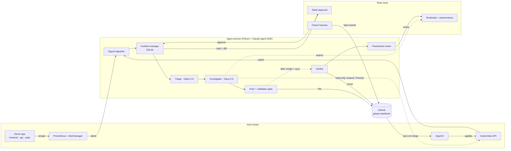
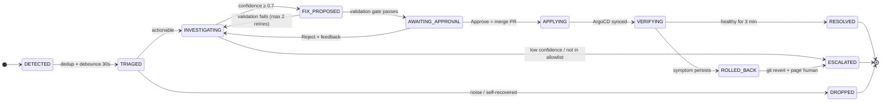
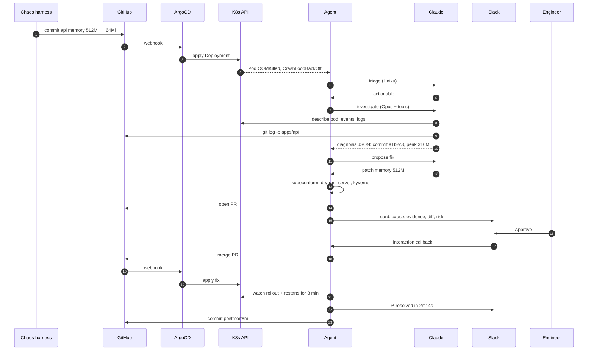

# Diagrams

GitHub renders these Mermaid diagrams inline. The hand-drawn architecture diagram is in [architecture.html](architecture.html).

## Architecture

The agent reads the cluster but never writes to it directly. Its only write path is a PR to the manifests repo. A human merges the PR from Slack, and ArgoCD applies the change.

## Incident lifecycle

## One incident: the bad memory limit

