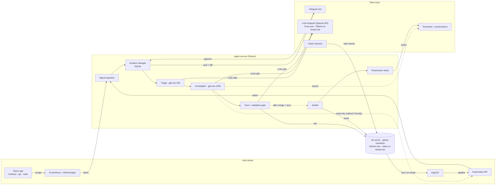
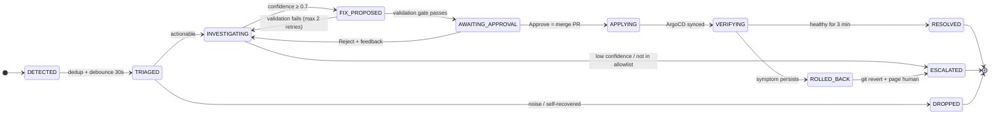
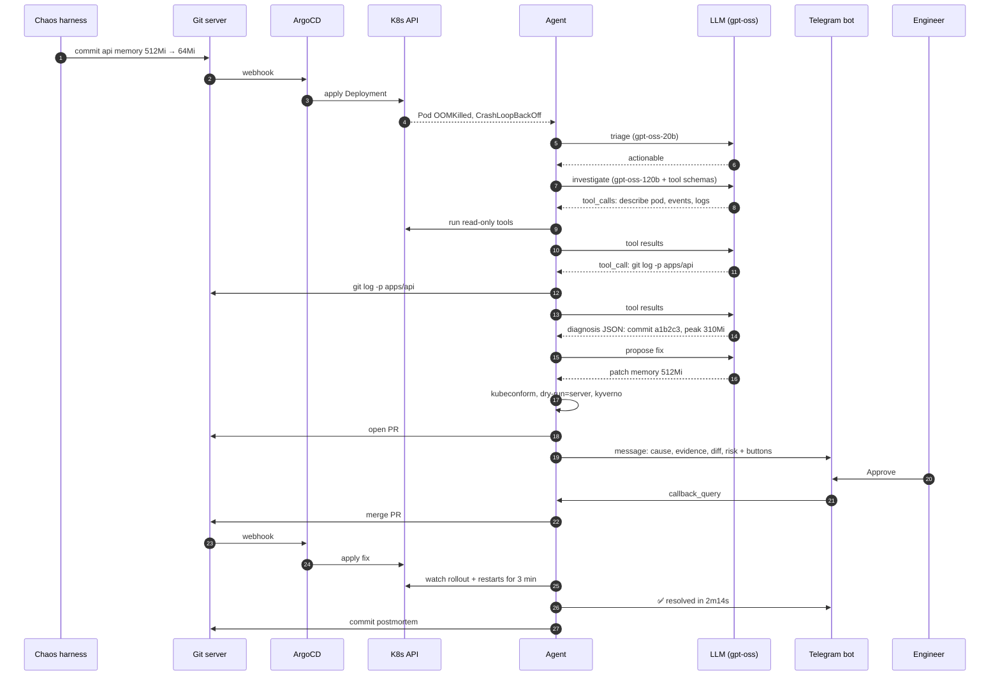

# Diagrams

GitHub renders these Mermaid diagrams inline. The hand-drawn architecture diagram is in [architecture.html](architecture.html).

## Architecture

The agent reads the cluster but never writes to it directly. Its only write path is a PR to the manifests repo. A human merges the PR from Telegram, and ArgoCD applies the change. All model calls go to one OpenAI-compatible endpoint: Groq at the hackathon, Ollama on the closed network.

## Incident lifecycle

## One incident: the bad memory limit

The model never touches the cluster. It only asks for tool calls; the agent runs them, and every tool is read-only.
